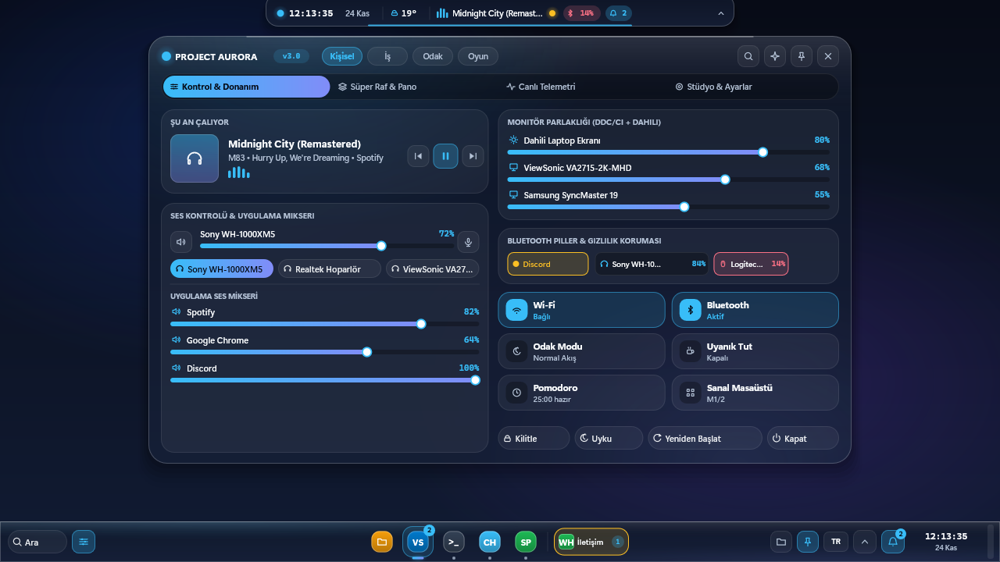
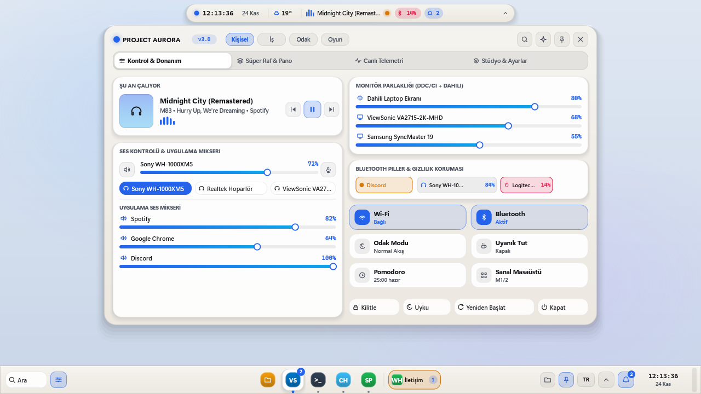

<div align="center">
  
  <h1>✦ Project Aurora v8.0</h1>
  <p><strong>Windows 11 için Saf Rust Motorlu Aurora OS Studio, Masaüstü Widget Motoru &amp; Kristal Görev Çubuğu</strong></p>
  <p>
    <a href="https://github.com/MuharremDidici/ProjectAurora/releases/latest">
      
    </a>
    
    
    
    
    
  </p>
</div>

**Project Aurora v8.0**, Windows 11 için **.NET 10 ve harici DLL bağımlılığı olmadan** **Saf Rust Win32 / Direct2D motoru + tek paylaşımlı WebView2 renderer** üzerinde geliştirilmiş; **yönetici izni (UAC) gerektirmeyen**, `explorer.exe`'ye dokunmayan veya DLL enjekte etmeyen, **çoklu monitör + karma DPI** destekli yeni nesil masaüstü kabuğudur.

---

## Gerçek Canlı Performans Kıyaslaması (`v2.5.1` .NET → Saf Rust Motoru)

*Ölçüm ortamı: Windows 11 x64 (`2560×1440 @ 125%` DPI), saniyeli saat, canlı pil/Bluetooth, bildirim köprüsü ve olay-tabanlı pano aktif.*

| Metrik | `v2.5.1` (C# .NET 10 + Çoklu WebView2) | **`v8.0` (Saf Rust + Tek Paylaşımlı WebView2)** | İyileşme |
| --- | ---: | ---: | ---: |
| **Çalışma Zamanı / Harici DLL** | .NET 10 (~198 MB, 220+ DLL) | **Saf Rust (1 `.exe`, 0 harici DLL)** | **%100 Bağımsız** |
| **Toplam WorkingSet RAM (Boşta)** | 490.1 MB | **53.0 MB** (`aurora.exe` 8.0 MB) | **9.2× Daha Düşük** |
| **Boşta CPU (Saniyeli Saat Açık)** | %0.71 | **%0.052** (`aurora.exe` %0.000) | **13.6× Daha Düşük** |
| **Arka Plan Pano & Bildirim G/Ç** | Sürekli polling | **`WM_CLIPBOARDUPDATE` + `mtime` kapılı + delta ikon IPC** | **%90+ Daha Hafif IPC** |
| **Soğuk Arayüz Hazır Süresi** | ~900 ms | **Crown 40 ms · Dock 72 ms** | **12× Daha Hızlı** |
| **Tek Dosya Kurulum Paketi** | 92.4 MB | **3.65 MB** (`zstd -19` atomik yükseltme) | **25× Daha Küçük** |

---

## v8.0 Başlıca Yetenekler

- **Flagship Tasarım & 26 WCAG AA+/AAA Tema (`v8.0.0`):**
  - 6 yeni amiral gemisi tema (`OLED Karbon`, `Kyoto Kâğıdı`, `Kuzey Buzulu`, `Gül Kadifesi`, `Zümrüt Stüdyo`, `Alabaster Sis`) ile toplam **26 WCAG AA+/AAA tema**, geliştirilmiş açık-mod kontrastı ve Stüdyo Cam görev çubuğu + masaüstü widget'ları.
  - Yüzey başına revizyon bazlı **`iconCacheDelta` IPC** ile tekrarlı durum iletilerinde `%90+` daha küçük payload boyutu, akıllı boşta telemetri kısma, otomatik `wpn_snap` anlık görüntü temizliği ve gelişmiş **OmniSearch** (AST hesap makinesi, birim/döviz çevirici, dünya saatleri, hızlı web/sistem komutları).
  - Tam çerçevesiz Dock ve Masaüstü Stüdyo Müzik Çubuğu (`0:00 —●—— 2:21` gerçek WinRT GSMTC zaman çizelgesi + canlı sürüklenebilir `mediaSeek` sarıcı, buzlu cam kontroller, ses seviyesi göstergesi).
  - İki satırlı Stüdyo Hava Durumu / Pil / CPU-RAM Dock widget'ları, başparmak topuzlu ince ses/parlaklık kaydırıcıları ve Dinamik Ada Canlı Sahne mini zaman çubuğu.

- **10 Özgün Kabuk Tasarım Mimarisi (Renklerden Bağımsız):** `Tahoe Cam`, `Nothing Donanım`, `Linear Stüdyo` *(ultra-ince `40 px` WorkArea)*, `Vision Küre`, `Arc Bölünmüş`, `Braun Atölye`, `Swiss Editoryal`, `Cockpit HUD`, `Fluent Mica` ve `Zen Hayalet` — her biri özgün yerleşim, kart geometrisi ve etkileşim diliyle gelir.
- **Yeni Nesil Dinamik Ada (`Aurora Crown`) & 4 Sekmeli Canlı Sahne:**
  - **6 Ada Stili + 3 Boşta Modu:** `Sıvı Hap`, `Mac Çentik`, `Ufuk Çizgisi`, `Nothing Kapsül`, `Cam Şerit`, `Yörünge Halka`; boşta `Sıvı Kapsül`, `Ufuk Çizgisi` veya `Akış` seçenekleri.
  - **Canlı Sahne & Donanım OSD HUD:** Medya/Bluetooth/Gizlilik LED ve `Canlı Sahne · Hızlı Kontrol · Araçlar · Telemetri` sekmeleri; CoreAudio (`<2 ms`) geri çağrımı ve donanım OSD HUD.
- **Alt Dock'tan Açılan OmniSearch & Gerçek Windows 11 Sistem Tepsisi:**
  - **Alt Dock Üstü Arama (`#omnibar`):** Başlat/Ara'ya basınca üst Dinamik Ada açılmadan doğrudan alt Dock'un hemen üzerinde açılır; 300+ Win32/MSIX uygulama, yerel dosya, hesap makinesi ve birim çevirici.
  - **Gerçek Windows 11 Sistem Tepsisi (`NotifyIconSettings`):** `GlobalProtect`, `MuMuPlayer`, `RustWTM`, `WhatsApp`, `Spotify`, `Teams`, `Docker Desktop` dahil 32 arka plan tepsi uygulaması gerçek ikonlarıyla listelenir; tıklandığında önce açık pencereye odaklanır, yoksa AUMID/EXE başlatır.
- **10 Masaüstü Widget'ı & 14 4-Bölgeli Sürükle-Bırak Dock Widget'ı:**
  - `HWND_BOTTOM` arka plan widget motoru (`Saat`, `Vinil/Cam Müzik`, `AI Kota ChatGPT/Gemini/Claude DPAPI şifreli`, `Bluetooth & Laptop Pil`, `Hava Durumu`, `Sistem Telemetri`, `Takvim`, `Yapışkan Not`, `Odak`, `Başlatıcı` — 5 yüzey stili, boş masaüstünde `%100` tıklama geçirgen).
  - Alt Dock üzerinde `En Sol / Uyg. Solu / Uyg. Sağ / En Sağ` bölgelerine sürüklenebilen 14 Dock widget'ı + 4 çoklu pencere dallanma stili (`Dendritic Küre`, `3D Yelpaze`, `Win11 Kartlar`, `Prism Arc`).
- **20 WCAG AA+ Tema + 2D HSV Canlı Özelleştirici + Duvar Kağıdı Vurgu Rengi:** Her tema için bağımsız kaydedilen renk, opaklık ve otomatik duvar kağıdı kontrast uyarlaması.
- **Endüstriyel Odak & Tek Tık Dış Kapanma (`v7.2.0`):**
  - `Alt+Tab` sırasında `VK_MENU` koruması ve senkron `ShowWindow` blokajı olmadan anında odak geçişi; tam ekran video algılamasında `XamlExplorerHostIslandWindow` / `MultitaskingViewFrame` istisnası.
  - Alt Tepsi dahil **tüm Dock ve Crown açılır menüleri** dışarıya veya Dock boşluğuna yapılan ilk tıklamada anında kapanır ve klavye odağını aktif pencereye geri bırakır.

---

## Ekran Görüntüleri

<table>
  <tr>
    <td width="50%" align="center">
      <strong>Liquid Glass — Kontrol &amp; Donanım</strong><br />
      
    </td>
    <td width="50%" align="center">
      <strong>Bento Silk — Porselen Açık Tema</strong><br />
      
    </td>
  </tr>
  <tr>
    <td width="50%" align="center">
      <strong>Mono Matrix — Nokta Matris &amp; 3-LED</strong><br />
      
    </td>
    <td width="50%" align="center">
      <strong>Cyber HUD — Kırpılmayan Neon &amp; Blueprint</strong><br />
      
    </td>
  </tr>
  <tr>
    <td width="50%" align="center">
      <strong>Stüdyo &amp; Canlı 2D HSV Renk Özelleştirici</strong><br />
      
    </td>
    <td width="50%" align="center">
      <strong>Süper Raf, SQLite Pano &amp; LAN QR AirDrop</strong><br />
      
    </td>
  </tr>
  <tr>
    <td width="50%" align="center">
      <strong>Canlı Telemetri Sparkline &amp; Bildirimler</strong><br />
      
    </td>
    <td width="50%" align="center">
      <strong>Yüzen Dock, Canlı OSD HUD &amp; Bildirim</strong><br />
      
    </td>
  </tr>
</table>

---

## Tek Tık Kurulum & Otomatik Yükseltme (Windows 11 x64 — 3.65 MB)

1. [Releases (Son Sürüm)](https://github.com/MuharremDidici/ProjectAurora/releases/latest) sayfasından **`Aurora-Kurulum-v8.0.0-x64.exe`** dosyasını indirin.
2. Çift tıklayıp **"Kurulumu Başlat"** butonuna basın — **Yönetici izni (UAC) veya .NET kurulumu gerekmez** (~2 saniyede kurulur).
3. **Eski Sürümlerden (`v2.x` .NET ve `v3.x+` Rust) Yükseltme:**
   - Mevcut kurulumlar uygulama içi **Güncelle** butonuyla `v8.0.0`'ı SHA-256 doğrulamalı olarak otomatik indirip kurar (`--update` ve `--silent` tam desteklidir).
   - `%LOCALAPPDATA%\ProjectAurora\data\` içindeki tüm ayarlarınız, sabit uygulamalarınız, widget yerleşiminiz, pano kasası ve ajandanız **%100 korunur**.

---

## Saf Rust Modüler Workspace Mimarisi (`aurora-rs/`)

```text
aurora-rs/ (8 Crate — Rust Stable + Win32 Native + Direct2D/DirectComposition + Shared WebView2)
├── crates/aurora-core/      # 10 kabuk mimarisi, 26 WCAG AA+ tema, WorkArea fiziği, modeller, omni hesap/fuzzy
├── crates/aurora-storage/   # Atomik JSON, WAL SQLite (aurora.db, clipboard_vault.db), SHA-256 + GitHub API güncelleyici
├── crates/aurora-render/    # Direct3D 11 / Direct2D 1.3 / DirectComposition motoru (OCR/GIF/Snap + aurora-setup)
├── crates/aurora-ui/        # Taffy Flexbox/Grid, HitTree, Türkçe UTF-8 metin girişi yardımcıları
├── crates/aurora-win32/     # Native AppBar, CoreAudio, DDC/CI EDID, Live Bluetooth, GSMTC, NotifyIconSettings, OCR/GIF/QR
├── crates/aurora-surfaces/  # Yüzey durum modelleri, veri köprüsü ve çoklu tema demo düzeni
├── crates/aurora-app/       # Hibrit Rust konağı (`aurora.exe`), tek paylaşımlı WebView2, Watchdog, Crown/Dock/Widgets UI
└── crates/aurora-setup/     # ~3.65 MB zstd-19 gömülü atomik retry sıfır-UAC kurulum & kaldırma sihirbazı
```

---

## Geliştiriciler İçin Derleme & Sürüm Yayınlama

```powershell
# Katı Clippy denetimi + tüm workspace birim testleri
cargo clippy --manifest-path .\aurora-rs\Cargo.toml --workspace --all-targets -- -D warnings
cargo test --manifest-path .\aurora-rs\Cargo.toml --workspace

# Tek dosya zstd-19 kurulum paketi ve SHA-256 manifesti (dist/)
.\Build-Installer.ps1 -Version "8.0.0"
```

Diğer belgeler: [Sürüm Notları](RELEASE_NOTES.md) · [Mimari Özeti](docs/Architecture/Architecture_Overview.md) · [Kurulum & Dağıtım](docs/Product/Tek_Tik_Kurulum_ve_Dagitim_Kilavuzu.md) · [Kod İmzalama](docs/Kod-Imzalama-ve-Dagitim.md) · [Görev Çubuğu Kurtarma](docs/QA/Native_Taskbar_Recovery_Guide.md) · [ADR-013 Saf Rust](docs/ADR/ADR-013-Pure-Rust-Hybrid-Shell-Evolution.md)
