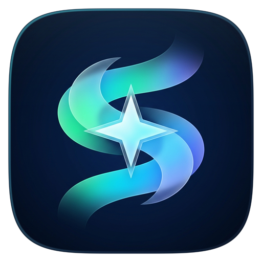
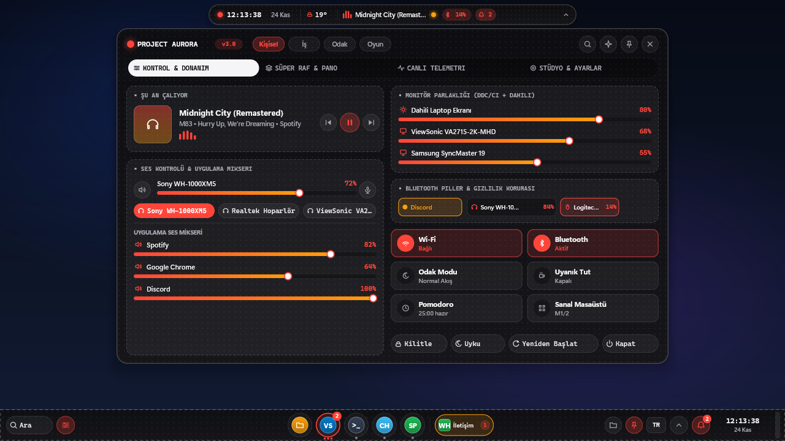
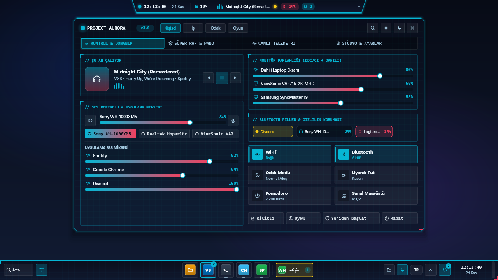
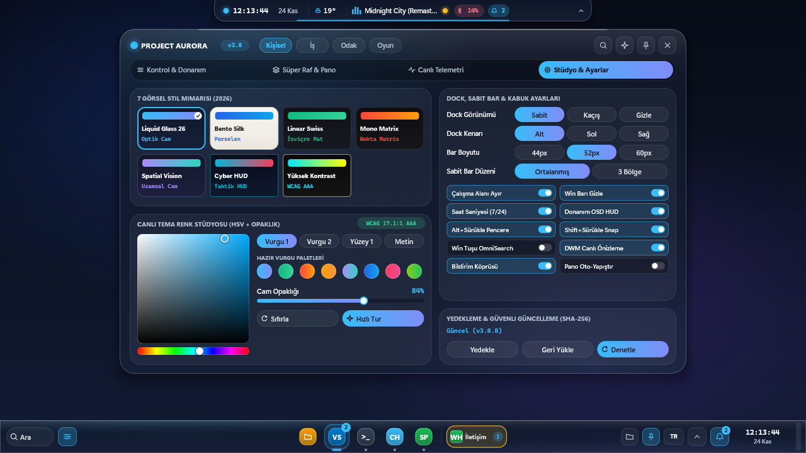
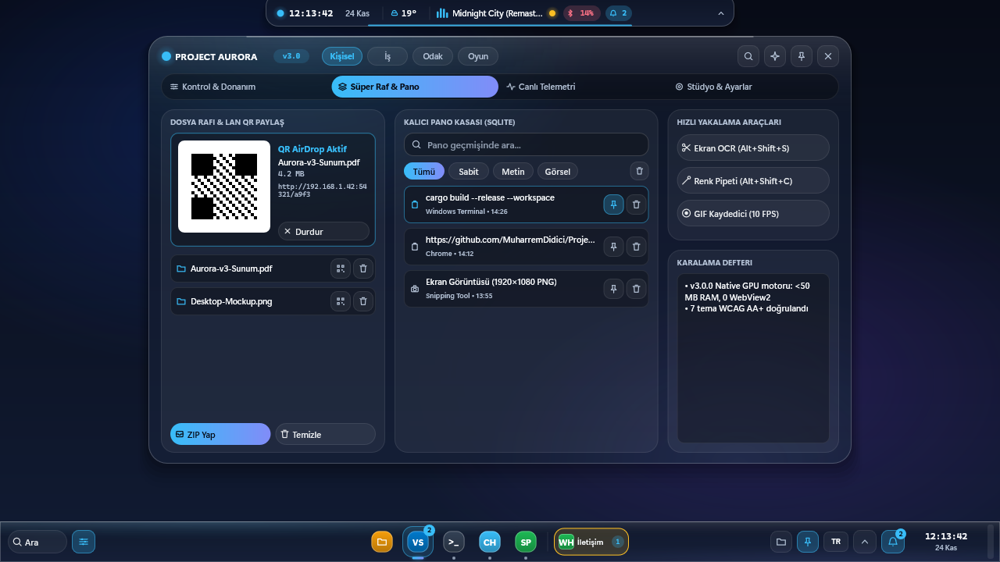
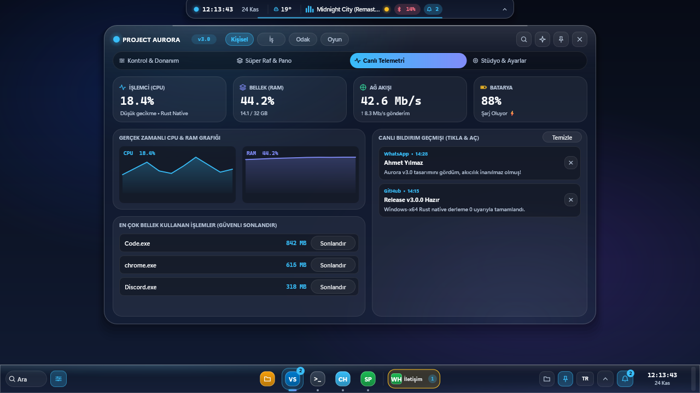
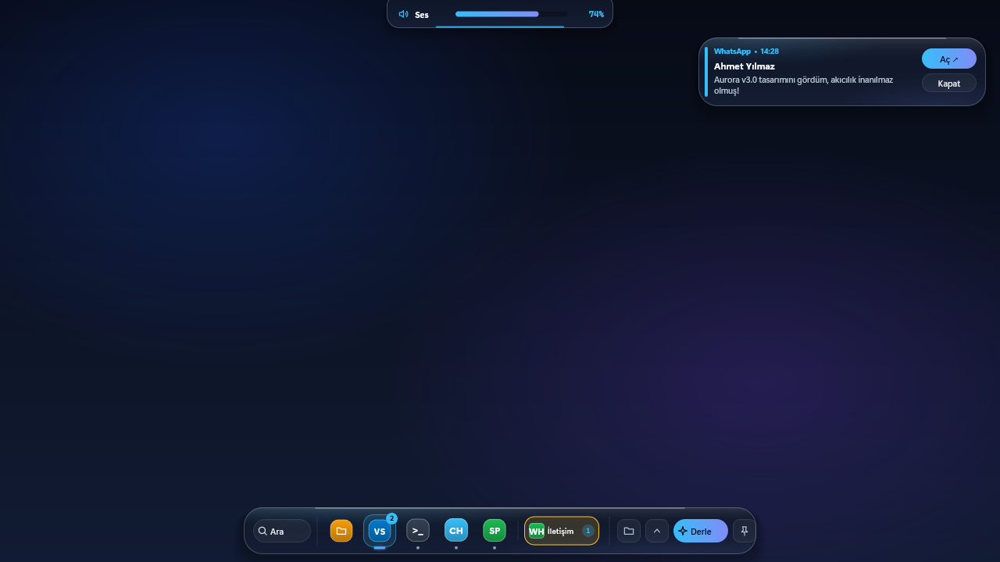

<div align="center">
  
  <h1>✦ Project Aurora v3.0</h1>
  <p><strong>Windows 11 için Saf Rust Motorlu Dinamik Ada (Aurora Crown) & Kristal Dock</strong></p>
  <p>
    <a href="https://github.com/MuharremDidici/ProjectAurora/releases/latest">
      
    </a>
    
    
    
    
    
  </p>
</div>

**Project Aurora v3.0**, Windows 11 için **.NET 10 ve harici DLL bağımlılığı olmadan** **Saf Rust Win32 / Direct2D motoru + tek paylaşımlı WebView2 renderer (`--process-per-site`)** üzerinde geliştirilmiş; **yönetici izni (UAC) gerektirmeyen**, `explorer.exe`'ye dokunmayan veya DLL enjekte etmeyen, **çoklu monitör + karma DPI** destekli yeni nesil masaüstü kabuğudur.

---

## Gerçek Canlı Performans Kıyaslaması (`v2.5.1` → `v3.0.0`)

*Ölçüm ortamı: Windows 11 x64 (`2560×1440 @ 125%` DPI), saniyeli saat, canlı pil/Bluetooth, bildirim köprüsü ve olay-tabanlı pano aktif.*

| Metrik | `v2.5.1` (C# .NET 10 + Çoklu WebView2) | **`v3.0.0` (Saf Rust + Tek Paylaşımlı WebView2)** | İyileşme |
| --- | ---: | ---: | ---: |
| **Çalışma Zamanı / Harici DLL** | .NET 10 (~198 MB, 220+ DLL) | **Saf Rust (1 `.exe`, 0 harici DLL)** | **%100 Bağımsız** |
| **Toplam WorkingSet RAM (Boşta)** | 490.1 MB | **53.0 MB** (`aurora.exe` 8.0 MB) | **9.2× Daha Düşük** |
| **Boşta CPU (Saniyeli Saat Açık)** | %0.71 | **%0.052** (`aurora.exe` %0.000) | **13.6× Daha Düşük** |
| **Arka Plan Pano & Bildirim G/Ç** | Sürekli polling | **`WM_CLIPBOARDUPDATE` + `mtime` kapılı (0 boşta SSD yazması)** | **~%70 Daha Az Uyandırma** |
| **Soğuk Arayüz Hazır Süresi** | ~900 ms | **Crown 40 ms · Dock 72 ms** | **12× Daha Hızlı** |
| **Tek Dosya Kurulum Paketi** | 92.4 MB | **3.39 MB** (zstd-19 atomik yükseltme) | **27.3× Daha Küçük** |

---

## 7 Görsel Mimari & Ekran Görüntüleri

<table>
  <tr>
    <td width="50%" align="center">
      <strong>Liquid Glass 26 — Kontrol & Donanım</strong><br />
      
    </td>
    <td width="50%" align="center">
      <strong>Bento Silk — Porselen Açık Tema</strong><br />
      
    </td>
  </tr>
  <tr>
    <td width="50%" align="center">
      <strong>Mono Matrix — Nokta Matris & 3-LED</strong><br />
      
    </td>
    <td width="50%" align="center">
      <strong>Cyber HUD — Kırpılmayan Neon & Blueprint</strong><br />
      
    </td>
  </tr>
  <tr>
    <td width="50%" align="center">
      <strong>Stüdyo & Canlı 2D HSV Renk Özelleştirici</strong><br />
      
    </td>
    <td width="50%" align="center">
      <strong>Süper Raf, SQLite Pano & LAN QR AirDrop</strong><br />
      
    </td>
  </tr>
  <tr>
    <td width="50%" align="center">
      <strong>Canlı Telemetri Sparkline & Tıklanabilir Bildirimler</strong><br />
      
    </td>
    <td width="50%" align="center">
      <strong>Yüzen Dock, Canlı OSD HUD & WhatsApp Bildirimi</strong><br />
      
    </td>
  </tr>
</table>

---

## Öne Çıkan Özellikler (Sıfır Özellik Ödünü)

- **Üst Damla (`Aurora Crown`) & Canlı Donanım Kontrolü:** Sıfır gecikmeli Donanım OSD HUD (CoreAudio `<2 ms` geri çağrı + Windows 11 OSD/bildirim bastırma), **anlık Laptop Pil % + Şarj Göstergesi** (`WM_POWERBROADCAST`), **yalnızca aktif bağlı Bluetooth cihazları & gerçek pil yüzdeleri** (`DEVPKEY_Device_IsConnected` + `ContainerId` gruplama), EDID + DXVA2 DDC/CI harici monitör parlaklığı, Kamera/Mikrofon Gizlilik LED'i, GSMTC medya & Uygulama Ses Mikseri, Uyanık Tut (Awake) ve Pomodoro.
- **Sabit Bar (`44/52/60 px`) ↔ Yüzen Kristal Dock & Dairesel Dallanan Pencere Küresi:** Gerçek Win32 `SHAppBarMessage` WorkArea korumasıyla WhatsApp, VS Code ve Antigravity alt yazı alanlarını asla kapatmaz; Merkez veya 3 Bölgeli düzen, `Alt / Sol / Sağ` kenar, Sıfır-Kaymalı Fitts Hover Dalgası, Klasör Yığınları, 60 FPS DWM Canlı Önizleme, **Sıfır-Kaymalı Dairesel Dallanan Pencere Küresi (Dendritic Orb Hub)** + tek üst kontrol şeridi (`Sol · Sağ · 50/50 · Üstte · + · ×`), `Alt+Sürükle` (Türkçe `AltGr` ve `Alt+Tab` korumalı) ve `Shift+Sürükle` Snap Zones (4 düzen).
- **Endüstriyel Kilitlenmez Girdi & Tıklama Geçirgenliği:** Sıfır `AttachThreadInput`, bloklamasız `WH_KEYBOARD_LL` / `WH_MOUSE_LL`, `ResizeObserver` senkronlu piksel-kesin `SetWindowRgn` tıklama geçirgenliği, donanım seviyesi `WS_EX_TRANSPARENT` Snap katmanı, kademeli soğuk başlatma & kendi kendini onaran WebView2 hidrasyon bekçisi ve `aurora.exe` çökse bile <100 ms içinde Windows görev çubuğunu kurtaran Watchdog.
- **Üretkenlik & Yakalama Merkezi:** Sürükle-bırak Dosya Rafı + ZIP + Yerel LAN QR AirDrop, sıfır-sorgulamalı (`WM_CLIPBOARDUPDATE`) SQLite Kalıcı Pano Kasası, Karalama Defteri, Türkçe Takvim & Günlük Ajanda, Çevrimdışı WinRT OCR (`Alt+Shift+S`), Canlı Renk Pipeti (`Alt+Shift+C`), 10 FPS GIF Kaydedici (`Alt+Shift+R` / otomatik `Ctrl+Alt+Shift+R` yedek), `Alt+Space` / `Win` OmniSearch (300+ uygulama/ayar, dosya, hesap makinesi, birim çevirici) ve Tıklanabilir 4-Katmanlı Canlı Bildirimler.
- **7 Özgün Görsel Mimari + Canlı Renk Stüdyosu:** `Liquid Glass 26`, `Bento Silk`, `Linear Swiss`, `Mono Matrix`, `Spatial Vision`, `Cyber HUD` ve `Yüksek Kontrast` — tüm temalar WCAG AA+ doğrulanmış ve her tema için bağımsız kaydedilen canlı renk + cam opaklığı özelleştiricisine sahip.

---

## Tek Tık Kurulum (Windows 11 x64 — 3.39 MB)

1. [Releases (Son Sürüm)](https://github.com/MuharremDidici/ProjectAurora/releases/latest) sayfasından **`Aurora-Kurulum-v3.0.0-x64.exe`** dosyasını indirin.
2. Çift tıklayıp **"Kurulumu Başlat"** butonuna basın — **Yönetici izni (UAC) veya .NET kurulumu gerekmez** (~2 saniyede kurulur, çalışan eski sürümü atomik olarak güvenle yükseltir ve önceki v2.x ayarlarınız / pano geçmişiniz %100 korunur).
3. Güncellemeler uygulama içindeki **Stüdyo & Ayarlar → Denetle** bölümünden **SHA-256** doğrulamasıyla tek tıkla kurulabilir.

---

## Saf Rust Modüler Workspace Mimarisi (`aurora-rs/`)

```text
aurora-rs/ (8 Crate — Rust Stable + Win32 Native + Direct2D/DirectComposition + Shared WebView2)
├── crates/aurora-core/      # 7 mimari tema, WCAG kontrast motoru, 120Hz yay fiziği, modeller, OmniSearch hesap/fuzzy
├── crates/aurora-storage/   # v2.x uyumlu atomik JSON, WAL SQLite (aurora.db, clipboard_vault.db), SHA-256 güncelleyici
├── crates/aurora-render/    # Direct3D 11 / Direct2D 1.3 / DirectComposition motoru (Transient Snap/OCR/GIF + Setup UI)
├── crates/aurora-ui/        # Taffy Flexbox/Grid, HitTree, Türkçe UTF-8 metin girişi yardımcıları
├── crates/aurora-win32/     # Native AppBar, CoreAudio, DDC/CI EDID, Live-Only Bluetooth, GSMTC, mtime WPN, OCR/GIF/QR
├── crates/aurora-surfaces/  # Yüzey durum modelleri, veri köprüsü ve çoklu tema demo düzeni
├── crates/aurora-app/       # Hibrit Rust konağı, tek paylaşımlı WebView2 (`https://aurora.local/`), Watchdog, Crown & Dock UI
└── crates/aurora-setup/     # 3.39 MB zstd-19 gömülü atomik retry saf Rust + Direct2D sıfır-UAC kurulum & kaldırma sihirbazı
```

---

## Geliştiriciler İçin Derleme & Sürüm Yayınlama

```powershell
# Katı Clippy denetimi + tüm birim testleri (24/24)
cargo clippy --manifest-path .\aurora-rs\Cargo.toml --workspace --all-targets -- -D warnings
cargo test --manifest-path .\aurora-rs\Cargo.toml --workspace

# 3.39 MB tek dosya kurulum paketi ve SHA-256 manifesti (dist/)
.\Build-Installer.ps1 -Version "3.0.0"
```
