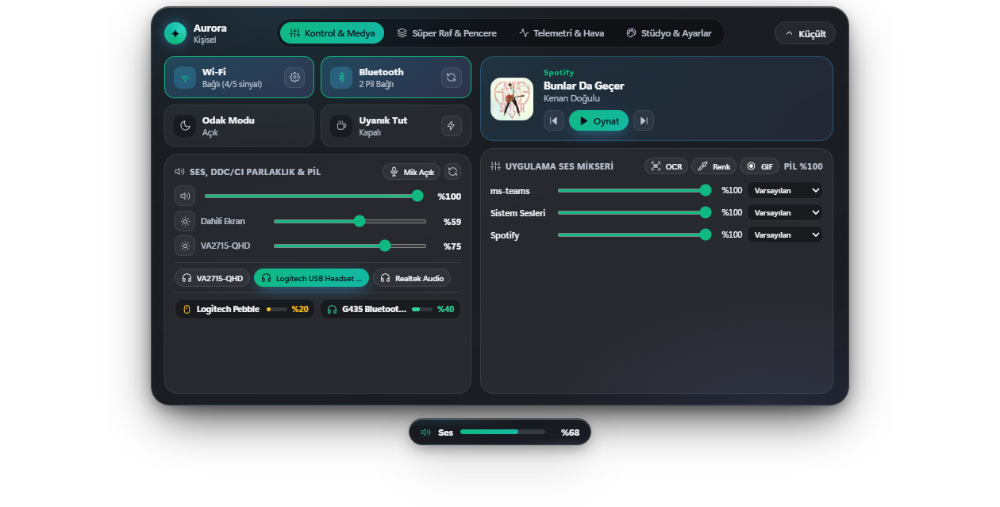
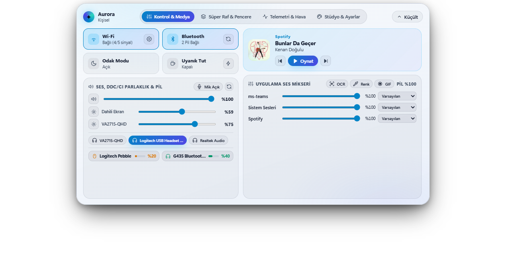
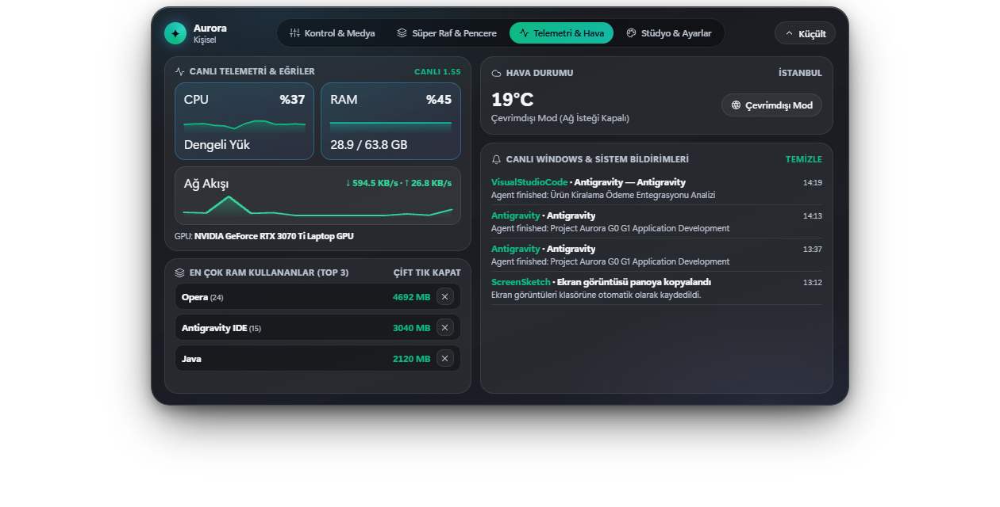
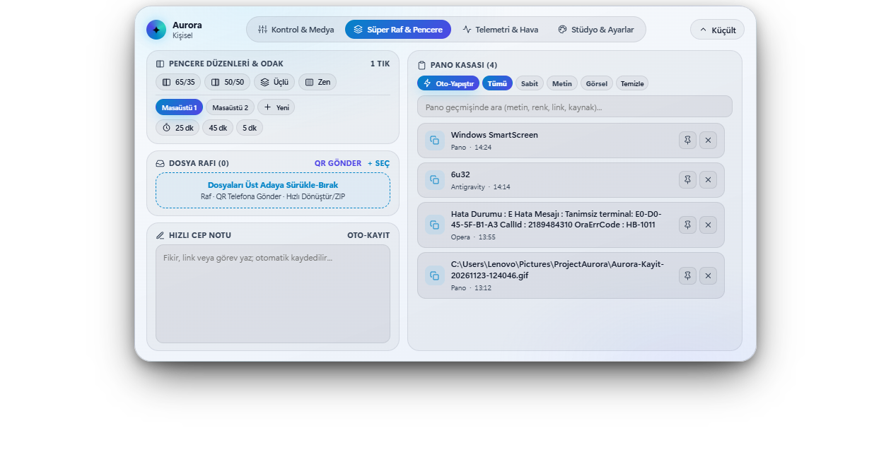
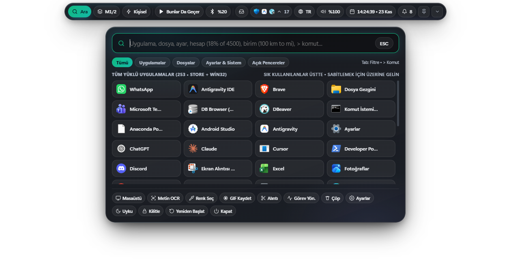

<div align="center">
  
  <h1>✦ Project Aurora</h1>
  <p><strong>Windows 11 için Yeni Nesil Dinamik Ada (Aurora Crown) & Kristal Dock</strong></p>
  <p>
    <a href="https://github.com/MuharremDidici/ProjectAurora/releases/latest">
      
    </a>
    
    
    
    
  </p>
</div>

**Project Aurora**, Windows 11 için `.NET 10` + `WebView2` + `DirectComposition` mimarisiyle geliştirilmiş; **yönetici izni (UAC) gerektirmeyen**, `explorer.exe`'ye dokunmayan veya DLL enjekte etmeyen, **çoklu monitör + karma DPI** destekli akışkan masaüstü deneyim katmanıdır.

---

## Ekran Görüntüleri (Koyu & Açık Tema)

<table>
  <tr>
    <td width="50%" align="center">
      <strong>Kontrol & Medya — Koyu Tema (Obsidian Pro)</strong><br />
      
    </td>
    <td width="50%" align="center">
      <strong>Kontrol & Medya — Açık Tema (Aurora Glass Açık)</strong><br />
      
    </td>
  </tr>
  <tr>
    <td width="50%" align="center">
      <strong>Canlı Telemetri Eğrileri & Top-3 RAM</strong><br />
      
    </td>
    <td width="50%" align="center">
      <strong>Süper Raf & Pano Kasası (Açık Tema)</strong><br />
      
    </td>
  </tr>
  <tr>
    <td width="50%" align="center">
      <strong>Alt+Space OmniSearch & Hızlı Araçlar</strong><br />
      
    </td>
    <td width="50%" align="center">
      <strong>Sol / Sağ Dikey Kristal Dock</strong><br />
      
    </td>
  </tr>
</table>

---

## Öne Çıkan Özellikler

### Üst Merkez Akışkan Damla (`Aurora Crown`)
- **Canlı Donanım OSD HUD:** Ses, sessiz, ekran parlaklığı, mikrofon, Caps Lock ve Num Lock değişimlerinde Windows'un varsayılan ses kutusunu bastırıp Üst Damla'da akıcı doluluk çubuğu gösterir.
- **Gerçek Harici Monitör Parlaklığı (EDID + DXVA2 DDC/CI):** Dahili dizüstü ekranları (`WMI`) ile birlikte harici monitörleri (`ViewSonic`, `Dell`, `LG`, `Samsung`, `ASUS` vb.) gerçek EDID model adıyla algılar ve son-değer-kazanır I2C birleştirmesiyle takılmadan kontrol eder.
- **Bluetooth Cihaz Pil Yüzdeleri:** Bağlı Bluetooth kulaklık, fare, klavye ve oyun kollarının pil yüzdesini (`cfgmgr32.dll` PnP + WinRT BLE GATT `0x180F`) cihaz türüne özel ikonlarla gösterir; %15 altında düşük pil uyarısı verir.
- **Kamera & Mikrofon Gizlilik LED'i:** Hangi uygulamanın kameranızı veya mikrofonunuzu kullandığını gerçek zamanlı (hayalet süreç korumalı) yeşil/turuncu LED ile bildirir.
- **3 Bölgeli Sürükle-Bırak + Yerel Ağ QR AirDrop + Hızlı Dönüştür/ZIP:** Dosyaları Üst Damla'ya bırakarak rafa koyun, aynı Wi-Fi'deki telefona yerel QR kodla saniyeler içinde aktarın veya tek harekette PNG↔JPG dönüştürüp ZIP'leyin.
- **10 FPS Animasyonlu GIF Kaydedici:** Seçtiğiniz ekran bölgesini tıklama-geçirgen kırmızı kayıt çerçevesiyle (kayda girmeyen `WDA_EXCLUDEFROMCAPTURE`) ve 4×4 Bayer dithering ile doğrudan GIF89a olarak kaydeder.
- **Kalıcı SQLite Pano Kasası & Oto-Yapıştır:** Metin, ekran görüntüsü, HEX/RGB renk kartı ve akıllı URL geçmişini saklar; tek tıkla önceki pencereye otomatik yapıştırır.
- **Canlı Telemetri Eğrileri & Çift-Tık Süreç Kapatma:** 1.5 sn canlı CPU/RAM/Ağ SVG eğrileri ve en çok RAM tüketen ilk 3 uygulama için 3.5 sn onay korumalı kapatma.
- **Çevrimdışı Ekran OCR, Renk Damlalığı & Uyanık Tut (Awake):** Görüntü/videodan anında metin okuma, piksel rengi alma ve tek tıkla uykuyu engelleme.
- **`Alt + Space` OmniSearch:** 250+ Store/Win32 uygulama + dosya arama, canlı hesap makinesi/birim çevirici ve tek tık sistem araçları.

### Kristal Dock (Alt Yatay / Sol Dikey / Sağ Dikey)
- **Sıfır Kaymalı Fitts Yasası Hover Dalgası:** İmleçle ikonlar arasında gezerken komşu ikonlar asla sağa-sola kaymaz, tıklayacağınız hedef yer değiştirmez.
- **Sol / Sağ Dikey Ray & 2×2 Akıllı Derle Mozaiği:** Dikey modda yalın mimari squircle ray, 175 ms niyet gecikmeli yan etiketler ve dikey sürükle-bırak sabitleme.
- **`Alt + Sürükle` Pencere & Dock Kontrolü:** Herhangi bir pencereyi `Alt + Sol Tık` ile taşıyıp `Alt + Sağ Tık` ile boyutlandırabilir; aynı hareketle Dock'u `Alt / Sol / Sağ` kenara taşıyıp `%75–%135` canlı ölçekleyebilirsiniz.
- **Akıllı Kaçınma (`SmartDodge`), Radyal Pencere Hub'ı, `Shift + Sürükle` Snap Zones ve Tam Ekran Oyun Uykusu.**

### GitHub Üzerinden Otomatik Güncelleme
- Yeni sürüm yayımlandığında Üst Damla'da otomatik bildirim gösterir.
- **Stüdyo & Ayarlar → Güncellemeleri Kontrol Et** üzerinden **SHA-256** doğrulamalı indirme, tüm ayarları koruyarak sessiz kurulum ve otomatik yeniden başlatma.

---

## Tek Tık Kurulum (Kullanıcılar İçin)

1. [Releases (Son Sürüm)](https://github.com/MuharremDidici/ProjectAurora/releases/latest) sayfasından **`Aurora-Kurulum-v*-x64.exe`** dosyasını indirin.
2. Çift tıklayıp **"Tek Tıkla Kur ve Başlat"** butonuna basın (ekstra .NET veya Yönetici izni gerekmez; ilk kurulumda imzasız derleme SmartScreen ekranı çıkarsa *Ek bilgi → Yine de çalıştır* seçin).
3. Kurulum Masaüstü ve Başlat Menüsü kısayollarını özel Aurora ikonuyla oluşturur; sonraki tüm güncellemeler uygulama içinden tek tıkla gelir.

> **Güvenli Kaldırma:** *Windows Ayarları → Yüklü Uygulamalar → Project Aurora → Kaldır* veya kurulum sihirbazındaki *"Mevcut Kurulumu Kaldır"* düğmesi Windows görev çubuğunu anında geri yükler.

---

## Modüler Proje Mimarisi

```text
Aurora.sln (18 Proje — .NET 10, Clean Architecture)
├── assets/                          # 7 boyutlu aurora.ico (16–256px) ve 512px aurora-icon.png
├── src/
│   ├── Aurora.App/                  # WinForms + DirectComposition + WebView2 kabuk konağı
│   │   ├── Program.cs               # Başlatma, crash watchdog, kısayol penceresi
│   │   ├── Coordinator/             # Partial alan koordinatörleri (Monitors, StateBroadcast, MessageRouter, OsdUpdaterAndCapture)
│   │   └── Host/
│   │       ├── TransparentSurfaceForm.cs  # Tek merkezi uyku destekli SurfaceHitTestCoordinator + DWM şeffaflık
│   │       ├── AuroraSurfaceTemplates.cs  # İnce HTML birleştirici
│   │       └── Templates/           # Shared, CrownStyles, CrownScript, DockStyles, DockScript
│   ├── Aurora.Platform.Windows/     # Win32, DDC/CI, Bluetooth PnP/BLE, Gizlilik LED, LAN QR, GIF89a, OCR, Alt+Drag
│   ├── Aurora.Core / Application / Infrastructure / Presentation / Taskbar / ControlCenter / Media / Widgets / Workspaces / Notifications / Personalization
├── installer/Aurora.Setup/          # Tek dosya self-contained kurulum + sessiz güncelleyici
└── tests/                           # 5 test projesi (71 otomatik test)
```

---

## Geliştiriciler İçin Derleme & Sürüm Yayınlama

```powershell
# Tam Release x64 derleme ve 71 otomatik test
dotnet build .\Aurora.sln -c Release -p:Platform=x64
dotnet test .\Aurora.sln -c Release -p:Platform=x64 --no-build

# Yerel tek-tık kurulum paketi üretme (dist/)
.\Build-Installer.ps1 -Version "2.3.0"
```

Yeni sürüm yayımlamak için `Directory.Build.props` içindeki `<Version>` değerini ve `RELEASE_NOTES.md` dosyasını güncelleyip etiket gönderin:

```powershell
git add .
git commit -m "Project Aurora v2.3.0"
git tag v2.3.0
git push origin main
git push origin v2.3.0
```

GitHub Actions ([.github/workflows/release.yml](.github/workflows/release.yml)) tüm testleri çalıştırır, kurulum `.exe`'si + SHA-256 `release-manifest.json` dosyasını üretir ve `RELEASE_NOTES.md` içeriğiyle otomatik olarak **GitHub Release** yayımlar.
